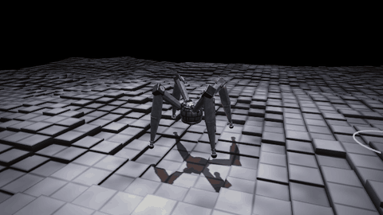

# arc-demo



A four-legged robot spider, modelled on the leaper from ARC Raiders, learns
by reinforcement learning to walk over rough block terrain and reach
checkpoints placed at random around it. It has to look where it goes: it
turns its eye towards each new checkpoint, then walks to it. Inspired by
Embark Studios'
[Transforming animation with machine learning](https://medium.com/embarkstudios/transforming-animation-with-machine-learning-27ac694590c).

The physics engine and renderer are written from scratch in C; training uses
[Stable Baselines3](https://stable-baselines3.readthedocs.io/) PPO.

## Setup

You need gcc with OpenMP, the SDL2 and OpenGL development files, and
[uv](https://docs.astral.sh/uv/).

```sh
make
uv sync
```

## Run the demo

```sh
uv run python scripts/enjoy.py models/leaper
```

This plays the trained agent that comes with the repository. Add
`--difficulty 0.6` to start on rougher terrain (0 is flat, 1 is the
hardest), or `--record out/leaper.gif` to save a GIF instead of opening a
window.

| key | action |
|---|---|
| 0-9 | terrain difficulty |
| R | new terrain |
| C | camera: behind / side / front |
| Space | pause |
| Esc, Q | quit |

Drag with the left mouse button to orbit the camera; scroll to zoom.

## Retrain the agent

The included agent was trained with these two commands, in about 50 minutes
on an 8-core laptop:

```sh
uv run python scripts/train.py --name leaper --steps 60e6
uv run python scripts/train.py --name leaper --steps 15e6 --lr 3e-4 --resume runs/leaper
```

The first trains from scratch, starting on flat ground and making the
terrain harder as the robot improves. The second fine-tunes the result,
which makes the robot fall much less often. Checkpoints are saved in
`runs/leaper/` every 2M steps; follow training with
`uv run tensorboard --logdir runs`.

To watch your agent, pass its run directory to `enjoy.py`, which plays the
latest checkpoint:

```sh
uv run python scripts/enjoy.py runs/leaper
```

To measure it, run `uv run python scripts/evaluate.py runs/leaper`: it prints
the checkpoints reached per minute and how often the robot falls, per
terrain difficulty. The included agent reaches about 24 checkpoints per
minute at every difficulty, and falls in under 0.5% of episodes up to
difficulty 0.75 and in 2% at difficulty 1.

## Project files

- `scripts/`: running the demo (`enjoy.py`), training (`train.py`) and
  evaluation (`evaluate.py`).
- `models/leaper/`: the trained agent.
- `arc/`: the Python package: the task, with its observations and rewards
  (`task.py`), the environments (`env.py`), bindings to the C code
  (`native.py`), and saving and loading agents (`runs.py`).
- `csrc/`: the C code: physics engine, robot, terrain, parallel simulation,
  renderer, and the `bin/arcview` physics viewer.
- `tests/`, `csrc/tests/`: tests, run with `uv run pytest` and `make test`.

## License

MIT, see [LICENSE](LICENSE).
